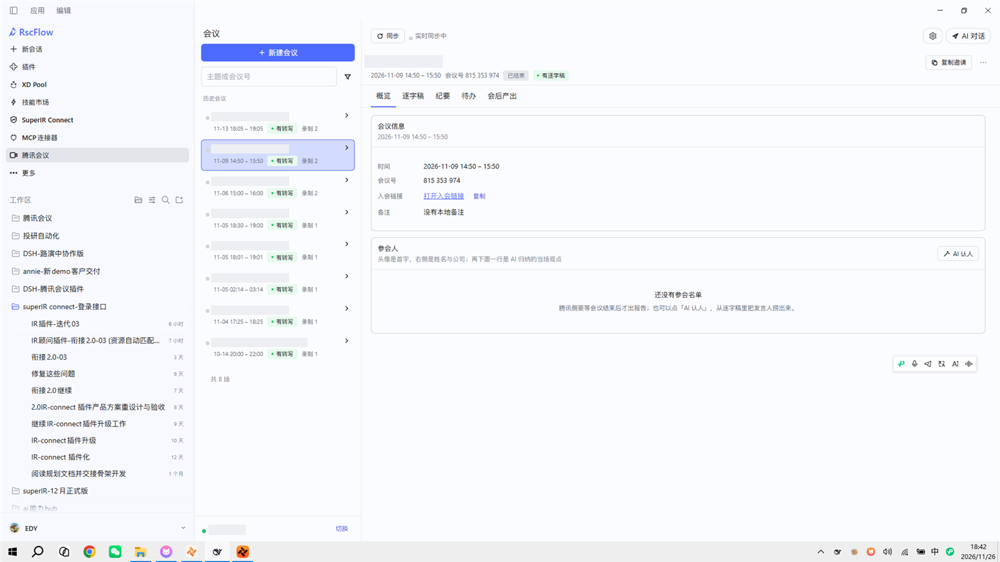
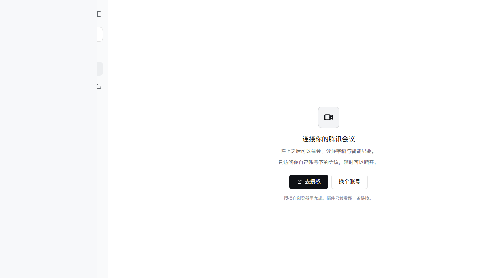
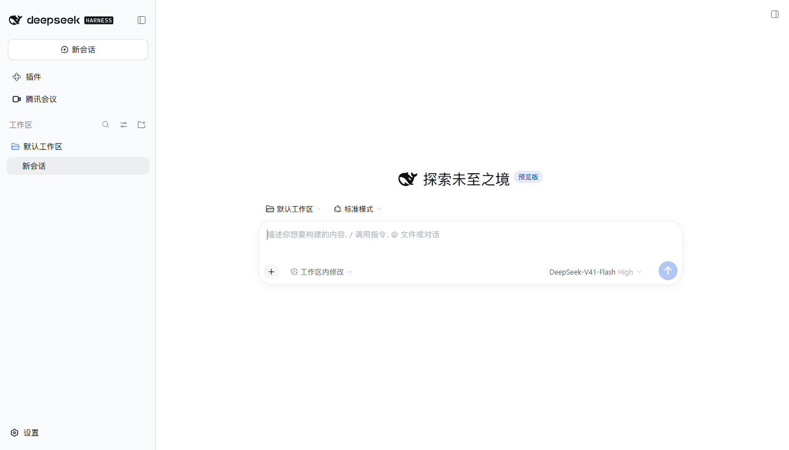
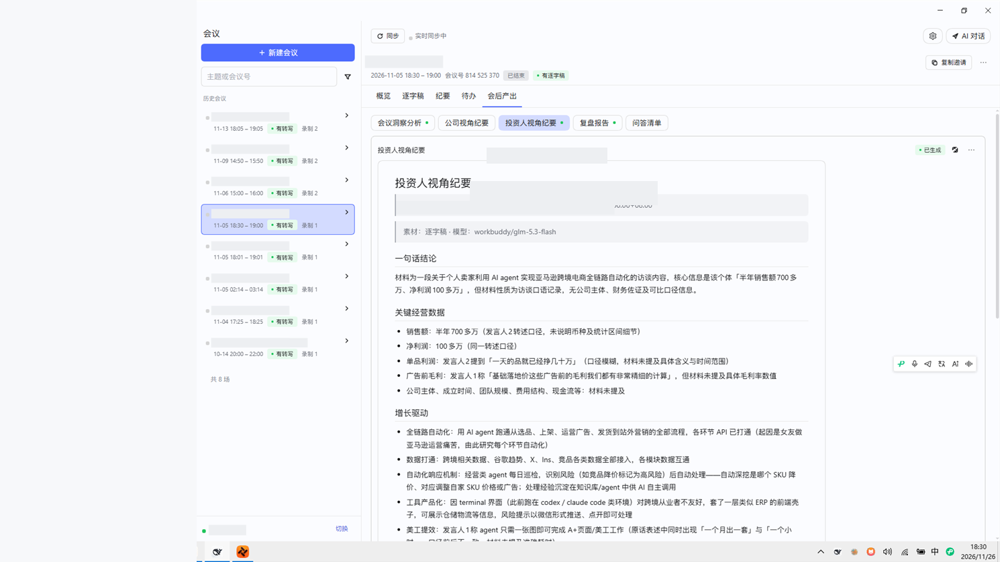

# dsh-tencent-meeting

Tencent Meeting inside DeepSeek Harness: manage meetings in a panel, drive them from tools in the conversation, and let your own DSH model turn a finished meeting into five documents.

This package is a thin shell around the official Tencent Meeting CLI (`@tencentcloud/tmeet`). Every meeting fact comes from that CLI. Every generated document comes from the model or the agent preset you configured in DSH.



## What it does

**In the panel.** A Tencent Meeting icon appears in the DSH sidebar. The home view separates in-progress and upcoming meetings from history; open any meeting for a detail page with tabs for transcript, smart minutes, timeline, todos and generated outputs. Creating, editing and cancelling meetings happens here too.

**In the conversation.** Fourteen `tm_*` tools are registered with DSH, covering list, search, read, create, update, cancel and minutes retrieval — no need to leave the chat. Any tool that asks which meeting accepts either the meeting ID or the 9-digit meeting code.

**After the meeting.** Five documents, produced on demand by your own model: meeting insight (how the room actually behaved — who drove it, who stayed quiet, with quoted evidence); company-view minutes for internal circulation; investor-view minutes for outside readers; a review report on what to change next time; and a Q&A list of what was asked and what was left unanswered. Eight `tm-*` skills cover scheduling, briefs, meeting writes and these five outputs, and the five can be turned off individually in settings.

Source material follows a strict order: verbatim transcript first, Tencent smart minutes second. With neither present, generation stops and says why instead of inventing minutes from a title.

## Why it is worth using

- **Writes are previewed before they happen.** Create, update, cancel, invite, participant edits and recording-permission requests all show what is about to change; nothing reaches Tencent Meeting until you confirm. Cancelling cannot be undone, and the confirmation shows the subject, time and meeting code first.
- **It does not fill gaps.** Missing material is reported as missing — no invented figures, no fabricated conclusions. Investor-view minutes summarise; they do not advise.
- **Credential boundaries are explicit.** The plugin never reads, copies or prints anything under `~/.tmeet`; sign-in stays with the CLI and only the authorisation link is relayed. Meeting data reaches only the model provider you configured, and only when you generate.
- **A thin shell, easy to read.** No bundled copy of `cordis`, `schemastery` or `dsh-tools` (they arrive as host peer dependencies), and no meeting mirror written to disk.

## Tool reference

All tools are registered on the DSH tool bus. Read-only tools declare `isConcurrencySafe: () => true`. Write tools take `confirm` and do nothing without it.

| Tool | What it returns |
| --- | --- |
| `tm_status` | One-screen self check: CLI path and version, login state, capabilities, active preferences. Never returns secrets. |
| `tm_meeting_list` | Upcoming or ended meetings from the local snapshot. Pass `refresh: true` to hit the API instead of the snapshot. |
| `tm_meeting_get` | One meeting: time, meeting code, join link, subject, and the settings that are actually in force after enterprise policy. |
| `tm_meeting_create` | Creates a meeting. Two-phase: preview first, submit on `confirm: true`. |
| `tm_meeting_update` | Changes a meeting. Two-phase, and reads the current recording and transcription settings back before patching so they are not reset to CLI defaults. |
| `tm_meeting_cancel` | Cancels a meeting. Two-phase. |
| `tm_meeting_search` | Keyword search across meetings. A time window wider than 31 days is clamped automatically. |
| `tm_record_summary` | Recording content: smart minutes, full transcript, speaker-segmented transcript, timeline, todos. |
| `tm_meeting_brief` | Generates a one-page brief (decisions, action items, open questions, risks) with your DSH model. |
| `tm_participants` | Participant list from the Tencent Meeting report, plus any locally added names. |
| `tm_output` | Lists, reads or deletes the five post-meeting outputs generated earlier. |
| `tm_plugin_info` | Package version, available models, available agent presets, installed skills, CLI diagnostics. |
| `tm_review_plan` | Decides which review lens fits a meeting (17 types), what material is available, and what is missing. Local only, no Tencent quota. |
| `tm_review_participation` | Who spoke how much (segments, characters, share) and who stayed silent, from the local transcript and roster. |

## Requirements

| Component | Minimum | Notes |
| --- | --- | --- |
| DSH | `0.2.1` and up | Verified on `0.2.2-rc.5`, both `dsh web` and the desktop build. |
| Node.js | `22` | Matches the DSH host runtime. |
| Tencent Meeting CLI | `1.1.0` | `@tencentcloud/tmeet`. Version `1.1.0` is the first release with `record content`, which the todos output depends on. |

The plugin does not redistribute the Tencent Meeting CLI. When the component is missing the panel shows an **Install meeting component** button; press it once and the plugin runs `npm i -g @tencentcloud/tmeet@1.1.0` with progress shown. Nothing is installed without that click, and you can always install it yourself beforehand. It carries no copy of `cordis`, `schemastery` or `dsh-tools`; those come from the host through `peerDependencies`.

### Version compatibility

| Layer | Requirement | What breaks when it is older |
| --- | --- | --- |
| DSH | `0.2.1` | The bundle manifest, tool bus and client slots this plugin uses do not exist below it. Current release `0.2.2-rc.5` is the tested target. |
| Node.js | `22` | Matching the host runtime; the plugin spawns the CLI through Node. |
| Tencent Meeting CLI | `1.1.0` | Reading recording content, searching meetings and todos need `record content` / `meeting search`, added in `1.1.0`. Older versions get a "needs upgrade" state, not silent failures. |

**Systems.** Windows 10/11 x64, macOS 12+ (Apple Silicon and Intel), Linux x64 and ARM64. The binary is located inside the installed npm package by its real platform filename, so a supported system is found rather than reported missing.

**Global install permission.** Installing the component writes to the npm global prefix. On macOS and Linux a system prefix such as `/usr/local` usually needs sudo; if that fails, install `@tencentcloud/tmeet@1.1.0` yourself once and the plugin finds it. The install always starts from a click in the panel — the plugin never installs anything on its own.

## Install

Two steps, roughly two minutes.

### 1. Install the plugin

```bash
dsh plugin add dsh-tencent-meeting
```

Restart DSH. A Tencent Meeting icon appears in the left sidebar and a **Tencent Meeting** section appears in settings.

When the component is missing, the panel shows a guide screen; press **Install meeting component** once and it runs `npm i -g @tencentcloud/tmeet@1.1.0` with progress shown. Nothing is installed without that click. To do that step yourself instead:

```bash
npm i -g @tencentcloud/tmeet@1.1.0
tmeet --version
```

### 2. Authorise

Open the panel. The first screen detects that you are not signed in and shows a single **Authorise** button. Press it, and the plugin forwards the OAuth device-code link printed by `tmeet auth login`. The browser handles the rest.

The plugin never reads, copies or prints anything under `~/.tmeet`. It only relays the link.



## Configuration

### Plugin config

Declared in `src/index.ts` as a Zod `Config` object. Every field has a default, so the plugin works immediately after installation. Values are volatile: the plugin reads them at call time, never inside `apply()`.

| Field | Default | Meaning |
| --- | --- | --- |
| `tmeetBinary` | `''` | Explicit path to the `tmeet` executable. Empty means auto-discover: config, then package `dist`, then `PATH`, then the npm global prefix. |
| `cliVersion` | `'1.1.0'` | CLI version to install or upgrade to when installing. |
| `requestTimeoutMs` | `20000` | Timeout for a single CLI command, in milliseconds. |
| `listCacheTtlMs` | `600000` | Lifetime of the meeting-list snapshot, in milliseconds. |
| `outputSkills` | `['insight', 'minutes-company', 'minutes-investor', 'review', 'qa']` | Which of the five output skills are registered. |

### Settings page

The **Tencent Meeting** section in DSH settings writes user preferences to `$DSH_HOME/plugin-data/dsh-tencent-meeting/prefs.json` (atomic write, falls back to defaults on a read failure, never throws). These are hot-reloadable and separate from the deployment-level `Config`.

| Field | Default | Meaning |
| --- | --- | --- |
| `provider` | `''` | Model provider for generated outputs. Empty follows the DSH default model. |
| `model` | `''` | Model name for generated outputs. Empty follows the DSH default model. |
| `agentPreset` | `''` | Agent preset to delegate generation to. Empty means a single direct model call; non-empty delegates through the `subagents` service and says so when delegation is unavailable. |
| `outputSkills` | `['insight', 'minutes-company', 'minutes-investor', 'review', 'qa']` | Which output skills are registered. Changing it unregisters and re-registers the skills. |
| `notifyOnReady` | `false` | Notify when a generation finishes. |



### Skills

Eight skills ship with the plugin. Five of them are controlled by `outputSkills` and can be switched off in settings.

| Skill | Purpose |
| --- | --- |
| `tm-schedule` | Answer "what meetings do I have today" from the panel data. |
| `tm-meeting-brief` | Turn a meeting detail, smart minutes or transcript into a one-page brief. |
| `tm-meeting-write` | Create or change a meeting with preview, then submit on confirmation. |
| `tm-output-insight` | Meeting insight: communication behaviour (talk share, listening, facilitation style) with quoted evidence. |
| `tm-output-company-minutes` | Company-view minutes. |
| `tm-output-investor-minutes` | Investor-view minutes. |
| `tm-output-review` | Post-meeting review report. |
| `tm-output-qa` | Q&A list extracted from the meeting. |

## Post-meeting outputs

Five documents, generated with the model or agent preset selected in settings.

| Output | Kind key | What it contains |
| --- | --- | --- |
| Meeting insight | `insight` | Communication behaviour: talk share, listening, facilitation style, with quoted evidence and one change to try. |
| Company-view minutes | `minutes-company` | Decisions, owners, deadlines and follow-ups written for internal circulation. |
| Investor-view minutes | `minutes-investor` | Business progress, numbers discussed and questions raised, written for an external reader. |
| Review report | `review` | What went well, what did not, and what to change next time. |
| Q&A list | `qa` | Every question asked and the answer given, as structured pairs. |

Source material is the verbatim transcript when available, and the Tencent Meeting smart minutes when it is not. If neither exists, generation stops and says the meeting has no usable material instead of inventing content. One generation run reads at most three meetings, and truncates material beyond 60,000 characters with a note in the output.



## Security boundaries

- **No credential access.** The plugin does not read, copy or print any file under `~/.tmeet`. Login always runs `tmeet auth login` as a subprocess; only the printed authorisation link is forwarded.
- **Nothing spawns at load.** `apply()` registers routes, tools, skills and slots. Zero child processes start until a tool call, an HTTP request or a click happens.
- **Writes are preview-first.** Create, update, cancel, invite, participant edits, per-recording permission requests and in-meeting control all require `confirm: true` after a preview is rendered.
- **Nothing is installed silently.** The panel asks before anything reaches your machine: press **Install meeting component** once and the plugin runs `npm i -g @tencentcloud/tmeet@1.1.0`, showing progress. Without that click, no install is attempted.
- **Quota respected.** The Tencent Meeting CLI has a daily call cap. The list reads a local snapshot by default; live data is fetched only when you press **Sync** or open the panel for the first time. The detail page does not prefetch per row.
- **No stack traces over the wire.** Every API failure returns `{ error, code }` with an appropriate 4xx status.

## Known limitations

| Limitation | Detail |
| --- | --- |
| No in-meeting live transcription | The plugin reads recording content after the meeting. There is no real-time subtitle stream. |
| Cannot read someone else's recording transcript | Viewing another organiser's recording requires owner approval. The panel shows the permission state and offers a request flow; it cannot bypass the approval. |
| Daily CLI quota | Tencent Meeting enforces a per-day call limit. Exceeding it returns error code `500246`; the panel and the tools report it as a quota error, not as a broken login. |
| No local meeting database | Unlike some integrations, this plugin stores no meeting mirror on disk. Meeting facts are always read from the CLI. |

## FAQ

**The panel says I am not signed in after I authorised.**
Confirm the CLI itself can see the session: run `tmeet auth status` in a terminal. If that reports signed out, the browser step did not complete. Press **Regenerate link** in the panel and finish the flow in the browser. Switching accounts requires `tmeet auth logout` first; the CLI rejects a second login while one is active.

**Error: CLI version mismatch.**
The plugin needs `@tencentcloud/tmeet` `1.1.0`. Older releases lack `record content`, so todos, timeline and the Q&A output cannot work. Run `npm i -g @tencentcloud/tmeet@1.1.0` and reopen the panel.

**Error code `500246`.**
That is the daily CLI call quota, not a login or permission problem. It resets the next day. Until then, the panel serves the local snapshot and read operations keep working.

**There is no transcript for a meeting.**
Three different causes look identical in the UI, so the detail page distinguishes them: recording was never enabled, transcription has not finished yet, or the meeting belongs to another organiser and requires approval. Each state shows its own message and, where possible, its own action.

**Output generation says it has no material.**
Neither a transcript nor smart minutes exist for that meeting. The plugin will not fabricate minutes from a title alone.

**Does it send my meeting data anywhere?**
Only to the model provider you configured in DSH settings, and only when you press generate. Meeting data is never sent to Tencent beyond the CLI calls the official client already makes.

## Roadmap

Version 1.0 is the current release. Version 2.0 merges the capabilities of the earlier `ikevss/ikevss-tencentmeeting` work: HTML invitation cards, email notification with an ICS calendar attachment, a richer post-meeting review report, and recognition of 17 meeting types. See [ROADMAP.md](ROADMAP.md) for the per-item breakdown of what gets built, why, and what it depends on.

## Development

```bash
npm install
npm run typecheck     # tsc --noEmit
npm run build:client  # bundle src/client into lib/client.js
npm run build         # typecheck + client bundle
npm run check         # node --check on both bundles
```

Source layout: `src/index.ts` is the entry and Config schema, `src/cli/` wraps the CLI (locate, install, exec, errors, command assembly), `src/services/` holds the domain layer, `src/routes.ts` is the `/tmeet/api` prefix, `src/tools.ts` registers the tools, `src/skills.ts` registers the skills, and `src/client/` is the React half.

## Screenshots

All screenshots live in [docs/screenshots](docs/screenshots). They are captured from a real running DSH instance.

| File | Shows |
| --- | --- |
| `home.png` | Panel home: in-progress and upcoming on the left, history on the right. |
| `outputs.png` | Post-meeting outputs tab: insight, company minutes, investor minutes, review, Q&A. |
| `create.png` | Create-meeting dialog: fill in, then confirm. |
| `settings.png` | The Tencent Meeting section in DSH settings. |
| `auth.png` | The not-signed-in guidance screen. |

## Contact

Issues, feature requests and questions: [github.com/ikevss/dsh-tencent-meeting](https://github.com/ikevss/dsh-tencent-meeting) · ikevss@qq.com

## License and notices

MIT. Copyright (c) 2026 ikevss. See [LICENSE](LICENSE) and [NOTICE](NOTICE).

- This project is not affiliated with, endorsed by or sponsored by Tencent. "Tencent Meeting" and 腾讯会议 are trademarks of their respective owner.
- The plugin does not redistribute the Tencent Meeting CLI; it invokes a copy installed from the official npm package `@tencentcloud/tmeet`.
- Screenshots come from a real installation, and any names visible in them have been masked. No meeting content is published.
