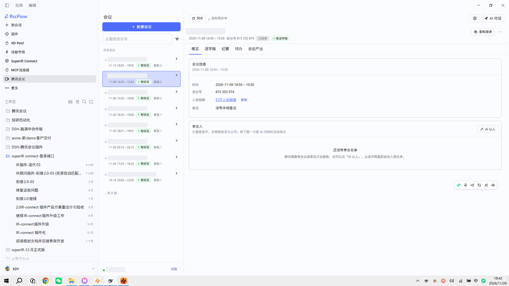
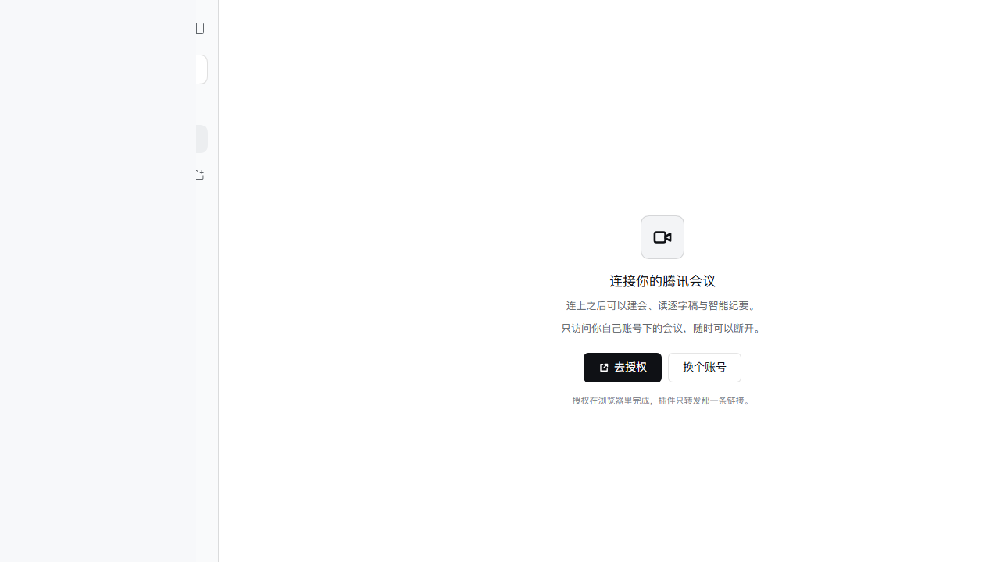
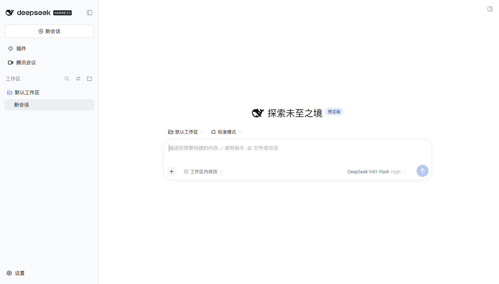

# dsh-tencent-meeting

把腾讯会议接进 DeepSeek Harness：在面板里管会议，在对话里用工具，会后五份文档交给你自己配置的 DSH 模型生成。

本包是腾讯会议官方 CLI（`@tencentcloud/tmeet`）的壳。所有会议事实都来自那个 CLI，所有生成的文档都来自你在 DSH 里选择的模型或 agent 预设。



## 能做什么

**面板里管会。** 左栏多一个腾讯会议图标。主页两栏：左边进行中与即将开始，右边历史会议。点进任何一场，详情页有逐字稿、智能纪要、时间轴、待办、会后产出五个页签。建会、改会、取消也在这里。

**对话里管会。** 14 个 `tm_*` 工具已注册进 DSH：列会、搜会、读详情、建会、改会、取消、取纪要，都不用离开聊天窗口。要指认某场会，会议 ID 或 9 位会议号都可以。

**会后出五份文档。** 会议洞察分析（看沟通方式：谁主导、谁没说话、有什么该说没说，带原话依据）；公司视角纪要（对内归档）；投资人视角纪要（对外读者）；复盘报告（这一场哪里好、下次改什么）；问答清单（问了什么、答了什么、哪些没答）。另有八条 `tm-*` 技能，覆盖查日程、出简报、建改会与这五份产出；五份产出可按需在设置里关闭。

素材规则：优先逐字稿，其次腾讯智能纪要；两者都没有就停下并说明，不会只凭标题编一份纪要。

## 为什么值得用

- **写操作先预览后确认。** 建会、改会、取消、邀请、改参会人、申请录制权限，都会先把将要发生的事摆出来，你确认才提交。取消不可恢复，确认前会先查出主题、时间、会议号给你核对。
- **不猜。** 拿不到的素材就如实说拿不到：不补数字、不编结论；投资人视角纪要做归纳，不给投资建议。
- **凭证边界写在明处。** 插件不读、不复制、不打印 `~/.tmeet` 下任何文件，登录交给 CLI，插件只转发授权链接；会议数据只发给你配置的模型供应商，且只在你按生成的那一刻。
- **一层薄封装，读完不费劲。** 不打包 `cordis`、`schemastery`、`dsh-tools`（走宿主的 peerDependencies），也不在磁盘上存会议镜像。

## 工具对照表

全部工具注册在 DSH 的工具总线上。只读工具声明 `isConcurrencySafe: () => true`；写工具都收 `confirm`，不给就不动作。

| 工具 | 返回什么 |
| --- | --- |
| `tm_status` | 一屏自检：CLI 路径与版本、登录状态、可用能力、当前偏好。不含任何密钥。 |
| `tm_meeting_list` | 从本地快照取即将开始或已结束的会议。传 `refresh: true` 才真取接口。 |
| `tm_meeting_get` | 单场会议：时间、会议号、入会链接、主题，以及企业策略之后真实生效的设置。 |
| `tm_meeting_create` | 建会。两阶段：先预览，`confirm: true` 才提交。 |
| `tm_meeting_update` | 改会。两阶段，且改之前先把当前的录制与转写设置读回来，避免被 CLI 默认值重置。 |
| `tm_meeting_cancel` | 取消会议。两阶段。 |
| `tm_meeting_search` | 按关键词搜会。时间窗超过 31 天会自动收紧。 |
| `tm_record_summary` | 录制内容：智能纪要、全文逐字稿、带说话人的分段、时间轴、待办。 |
| `tm_meeting_brief` | 用你的 DSH 模型生成一页简报（结论、待办、未决问题、风险）。 |
| `tm_participants` | 参会人名单，来自腾讯会议报告接口，外加本地补充的名字。 |
| `tm_output` | 列出、读取或删除已生成的五份产出。 |
| `tm_plugin_info` | 包版本、可选模型、可选 agent 预设、已装技能、CLI 诊断信息。 |
| `tm_review_plan` | 判定这场会该用哪种复盘视角（17 类）、有哪些素材、缺什么。只读本地，不耗腾讯额度。 |
| `tm_review_participation` | 谁发言多少（段数/字数/占比）、谁没说话，数据来自本机逐字稿与名单。 |

## 系统要求

| 组件 | 最低版本 | 说明 |
| --- | --- | --- |
| DSH | `0.2.1` | `dsh web` 与桌面端均已实测。 |
| Node.js | `22` | 与 DSH 宿主运行时一致。 |
| 腾讯会议 CLI | `1.1.0` | 即 `@tencentcloud/tmeet`。`1.1.0` 是第一个带 `record content` 的版本，待办产出依赖它。 |

插件不随包分发腾讯会议 CLI。缺组件时面板会显示引导页，点一次「安装会议组件」就会执行 `npm i -g @tencentcloud/tmeet@1.1.0` 并显示进度；也可以自己提前装好。它不携带 `cordis`、`schemastery`、`dsh-tools` 的副本，这几个都通过 `peerDependencies` 使用宿主提供的版本。

### 版本兼容

| 层 | 要求 | 低于该版本会怎样 |
| --- | --- | --- |
| DSH | `0.2.1` | 本插件依赖的 bundle 清单、工具总线与客户端插槽都还不存在。 |
| Node.js | `22` | 与 DSH 宿主运行时一致；插件通过 Node 起 CLI 子进程。 |
| 腾讯会议 CLI | `1.1.0` | 读录制内容、搜会、看待办依赖 `record content` / `meeting search`，这些是 `1.1.0` 才有的。版本低会明确提示升级，不会静默失败。 |

**支持的系统。** Windows 10/11 x64、macOS 12+（Apple Silicon 与 Intel）、Linux x64 与 ARM64。二进制是按 npm 包里的真实平台文件名查找的，支持的系统一定能找到，不会被误报成「没装」。

**全局安装权限。** 装组件要写入 npm 全局目录。macOS / Linux 上如果是 `/usr/local` 这类系统目录，通常需要 sudo；装不上就自己执行一次 `@tencentcloud/tmeet@1.1.0`，插件会找到它。任何安装都从你在面板里点一下开始，插件不会自己动手。

## 安装

两步，大约两分钟。

### 1. 安装插件

```bash
dsh plugin add dsh-tencent-meeting
```

重启 DSH。左栏出现腾讯会议图标，设置里出现「腾讯会议」一节。

之后首次用到时，会议组件会自动装好（`npm i -g @tencentcloud/tmeet@1.1.0`）。如果你想自己动手：

```bash
npm i -g @tencentcloud/tmeet@1.1.0
tmeet --version
```

### 2. 授权

打开面板。首屏会检测到未登录，只给一个「去授权」按钮。点它，插件把 `tmeet auth login` 打印的 OAuth 设备码链接转发给你，剩下的在浏览器里完成。

插件不读、不复制、不打印 `~/.tmeet` 下的任何文件，只转发那一条链接。



## 配置

### 插件配置

在 `src/index.ts` 里以 Zod `Config` 对象声明。每个字段都有默认值，装完即用。值是易变的：插件在调用时读取，`apply()` 内不读。

| 字段 | 默认值 | 含义 |
| --- | --- | --- |
| `tmeetBinary` | `''` | 显式指定 `tmeet` 可执行文件路径。空表示自动查找：配置项、包内 `dist`、`PATH`、npm 全局前缀，依次尝试。 |
| `cliVersion` | `'1.1.0'` | 安装或升级时要装到的 CLI 版本。 |
| `requestTimeoutMs` | `20000` | 单条 CLI 命令超时，单位毫秒。 |
| `listCacheTtlMs` | `600000` | 会议列表快照有效期，单位毫秒。 |
| `outputSkills` | `['insight', 'minutes-company', 'minutes-investor', 'review', 'qa']` | 注册哪几份产出技能。 |

### 设置页

DSH 设置里的「腾讯会议」一节会把用户偏好写到 `$DSH_HOME/plugin-data/dsh-tencent-meeting/prefs.json`（原子写，读失败回退默认值，绝不抛异常）。这一层可热更，与部署级的 `Config` 分开。

| 字段 | 默认值 | 含义 |
| --- | --- | --- |
| `provider` | `''` | 生成产出用的模型供应商。空表示跟随 DSH 默认模型。 |
| `model` | `''` | 生成产出用的模型名。空表示跟随 DSH 默认模型。 |
| `agentPreset` | `''` | 委派生成用的 agent 预设。空表示单发一次模型调用；非空则走 `subagents` 服务委派，委派不可用时会明确告知，不静默降级。 |
| `outputSkills` | `['insight', 'minutes-company', 'minutes-investor', 'review', 'qa']` | 注册哪几份产出技能。变更时先反注册再注册。 |
| `notifyOnReady` | `false` | 生成完成时是否通知。 |



### 技能

插件带八个技能。其中五个受 `outputSkills` 控制，可以在设置里关掉。

| 技能 | 用途 |
| --- | --- |
| `tm-schedule` | 基于面板数据回答「今天有哪些会」。 |
| `tm-meeting-brief` | 把会议详情、智能纪要或逐字稿整理成一页简报。 |
| `tm-meeting-write` | 建会或改会：先预览，确认后提交。 |
| `tm-output-insight` | 会议洞察：沟通行为（发言占比、倾听、引导风格），带原话依据。 |
| `tm-output-company-minutes` | 公司视角纪要。 |
| `tm-output-investor-minutes` | 投资人视角纪要。 |
| `tm-output-review` | 会后复盘报告。 |
| `tm-output-qa` | 问答清单。 |

## 会后产出

五份文档，用设置页里选的模型或 agent 预设生成。

| 产出 | 类型键 | 内容 |
| --- | --- | --- |
| 会议洞察分析 | `insight` | 沟通行为：发言占比、倾听、引导风格，带原话依据和一条改进动作。 |
| 公司视角纪要 | `minutes-company` | 决议、责任人、截止时间、后续动作，面向对内传阅。 |
| 投资人视角纪要 | `minutes-investor` | 业务进展、讨论到的数字、提出的问题，面向对外读者。 |
| 复盘报告 | `review` | 哪些做得好、哪些没做好、下次改什么。 |
| 问答清单 | `qa` | 会上提出的每个问题与对应回答，整理成结构化问答对。 |

素材优先取逐字稿，没有就用腾讯会议的智能纪要。两者都没有时，生成会停下并说明「这场会没有可用素材」，不会凭空编造。单次生成最多读 3 场会；素材超过 6 万字会截断，并在产出里注明。


## 安全边界

- **不碰凭证。** 插件不读、不复制、不打印 `~/.tmeet` 下任何文件。登录一律以子进程运行 `tmeet auth login`，只转发它打印的授权链接。
- **加载时不启进程。** `apply()` 只注册路由、工具、技能与插槽。在工具调用、HTTP 请求或用户点击发生之前，不启动任何子进程。
- **写操作先预览。** 建会、改会、取消、邀请、改参会人、单场录制权限申请、会中控制，都要先渲染预览，`confirm: true` 才提交。
- **不静默安装。** 面板会先问过你：点一次「安装会议组件」，插件才执行 `npm i -g @tencentcloud/tmeet@1.1.0` 并显示进度。没有这一下点击，不会有任何安装动作。
- **尊重配额。** 腾讯会议 CLI 有日调用上限。列表默认读本地快照；只有你点「同步」或首次进面板时才真取数。详情页不逐行预取。
- **不把堆栈发给前端。** 任何接口失败都返回 `{ error, code }` 加合适的 4xx 状态码。

## 已知限制

| 限制 | 说明 |
| --- | --- |
| 不支持会中实时转写 | 插件读的是会后的录制内容，没有实时字幕流。 |
| 看不到别人录制的转写 | 查看其他主持人的录制需要所有者审批。面板会显示审批状态并提供申请入口，但无法绕过审批。 |
| CLI 有每日调用额度 | 腾讯会议按天限制调用次数，超了返回错误码 `500246`；面板与工具都会当作额度问题报告，而不是误报成登录失效。 |
| 不落本地会议库 | 与其他集成不同，本插件不在磁盘上存会议镜像。会议事实一律从 CLI 读。 |

## 常见问题

**授权之后面板还显示未登录。**
先在终端确认 CLI 自己能看见会话：运行 `tmeet auth status`。如果那边也显示未登录，说明浏览器那一步没走完。在面板里点「重新生成链接」再走一遍。切换账号必须先 `tmeet auth logout`，CLI 在已有登录状态时会拒绝再次登录。

**报错说 CLI 版本不匹配。**
插件需要 `@tencentcloud/tmeet` `1.1.0`。更早的版本没有 `record content`，待办、时间轴和问答产出都跑不了。执行 `npm i -g @tencentcloud/tmeet@1.1.0` 后重新打开面板。

**错误码 `500246`。**
那是每日 CLI 调用额度用完了，不是登录失效，也不是权限问题。次日重置。在此之前面板继续提供本地快照，读操作照常可用。

**这场会没有逐字稿。**
三种不同的原因在界面上看起来一样，所以详情页会区分：根本没开录制、转写还没跑完、或者这场会属于别人需要审批。每种状态给各自的说明，能给的还给对应的操作入口。

**生成产出时说没有素材。**
这场会既没有逐字稿也没有智能纪要。插件不会只凭一个标题就编出纪要。

**它会把我的会议数据发到哪里？**
只会发到你在 DSH 设置里配置的模型供应商，而且只在你点生成时。除官方 CLI 本来就会发出的调用之外，会议数据不会再发给腾讯。

## 路线图

1.0 是当前版本。2.0 会融合早前 `ikevss/ikevss-tencentmeeting` 的能力：HTML 邀请函、邮件通知带 ICS 日历附件、更完整的会后复盘报告、17 种会议类型识别。每一项做什么、为什么、依赖什么，见 [ROADMAP.md](ROADMAP.md)。

## 开发

```bash
npm install
npm run typecheck     # tsc --noEmit
npm run build:client  # 打包 src/client 到 lib/client.js
npm run build         # 类型检查 + 客户端打包
npm run check         # 对两个产物跑 node --check
```

源码分工：`src/index.ts` 是入口与配置声明，`src/cli/` 包 CLI（查找、安装、执行、错误码、命令拼装），`src/services/` 是领域层，`src/routes.ts` 是 `/tmeet/api` 前缀路由，`src/tools.ts` 注册工具，`src/skills.ts` 注册技能，`src/client/` 是 React 那一半。

## 截图

所有截图放在 [docs/screenshots](docs/screenshots)，取自真实运行的 DSH 界面。

| 文件 | 拍什么 |
| --- | --- |
| `home.png` | 面板主页：左侧进行中与历史会议，右侧详情。 |
| `outputs.png` | 会后产出页签：会议洞察分析、公司视角纪要、投资人视角纪要、复盘报告、问答清单。 |
| `create.png` | 建会弹窗：填内容、确认两步。 |
| `settings.png` | DSH 设置里的腾讯会议一节。 |
| `auth.png` | 未登录引导屏。 |

## 联系

问题、需求与讨论：[github.com/ikevss/dsh-tencent-meeting](https://github.com/ikevss/dsh-tencent-meeting) · ikevss@qq.com

## 许可证与声明

MIT，版权归 ikevss，2026 年。见 [LICENSE](LICENSE) 与 [NOTICE](NOTICE)。

- 本项目与腾讯无关，未获腾讯认可或赞助。「腾讯会议」及其标识归其权利人所有。
- 插件不分发腾讯会议 CLI，只调用你从官方 npm 包 `@tencentcloud/tmeet` 装好的那份。
- 截图取自真实运行环境，其中可见的姓名均已打码，不公开任何会议内容。
